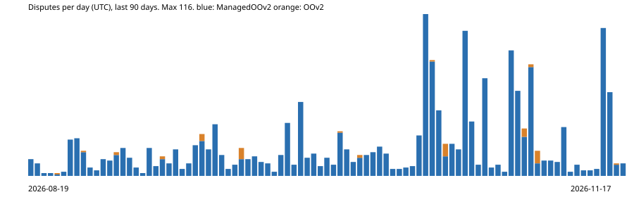

# UMA optimistic oracle disputes on Polygon: monitor, rebuilt on each run

What happens to price requests that get disputed on UMA's OptimisticOracleV2 and ManagedOptimisticOracleV2 on Polygon,
rebuilt from public RPC logs. It is not a live feed: `python3 update.py` re-fetches the logs and rewrites every number
between the markers below, and stamps the time of the last run. Interpretation sentences that contain numbers are generated
from the tables in the same run; the static text outside the markers contains no refreshed figures.

<!-- NUMBERS:START -->
Rebuilt: **2026-11-17 10:46 UTC** by `update.py` (a manual run, not a live feed). Last block: **97470920** (2026-11-17 10:37 UTC). Proposals: last 90 days. Disputes and settlements: last 365 days. Source: Polygon logs via a public RPC. All rates are per request, not per market. Monthly tables use disputes at least 7 days old.

**What this measures.** Disputes are chosen by disputers, who post a bond to raise them. These tables measure how often disputers prevail and what the vote returns; they do not measure how often proposals are wrong. Wrong proposals that nobody disputed are not in the data, and the dispute rate is not an error rate.

### Outcome of settled disputes: reset, overturned, upheld
Shares of ALL settled disputes. *Reset* = the vote returned "too early", which tells the market to ask again. *Overturned* = decided on substance and the settled price differs from the proposed one. *Upheld* = decided on substance and the proposer was confirmed. *Midpoint* = settled at 0.5e18, shown on its own and inside the other columns. How to read a midpoint settlement is not tested here: it can follow a cancelled game, or a proposer who ignored the rules. *Overturned of decided* is the older ratio, overturned / (overturned + upheld); it moves partly because upheld cases turn into resets, so read it with the first three columns. Disputes with no `Settle` yet are not counted.

| Period | Settled disputes | Reset | Overturned | Upheld | Midpoint | Overturned of decided | Under 7 days old, left out |
|---|---|---|---|---|---|---|---|
| 2025-11 | 78 | 43.6% | 19.2% | 37.2% | 2.6% | 34.1% | 0 |
| 2025-12 | 205 | 50.7% | 15.6% | 33.7% | 1.5% | 31.7% | 0 |
| 2026-01 | 325 | 58.5% | 18.2% | 23.4% | 1.5% | 43.7% | 0 |
| 2026-02 | 243 | 49.8% | 22.2% | 28.0% | 4.9% | 44.3% | 0 |
| 2026-03 | 362 | 51.7% | 17.4% | 30.9% | 5.0% | 36.0% | 0 |
| 2026-04 | 278 | 32.0% | 24.8% | 43.2% | 4.0% | 36.5% | 0 |
| 2026-05 | 307 | 54.1% | 15.0% | 30.9% | 0.7% | 32.6% | 0 |
| 2026-06 | 262 | 55.0% | 13.0% | 32.1% | 0.0% | 28.8% | 0 |
| 2026-07 | 318 | 51.6% | 32.4% | 16.0% | 0.0% | 66.9% | 0 |
| 2026-08 | 427 | 45.7% | 25.1% | 29.3% | 5.4% | 46.1% | 0 |
| 2026-09 | 470 | 49.8% | 27.7% | 22.6% | 7.7% | 55.1% | 0 |
| 2026-10 | 880 | 68.0% | 25.2% | 6.8% | 0.7% | 78.7% | 0 |
| 2026-11 | 268 | 63.8% | 17.5% | 18.7% | 4.1% | 48.5% | 200 |
| last 90d | 1752 | 60.9% | 25.6% | 13.5% | 3.8% | 65.5% | 200 |
| 12 months | 4423 | 54.2% | 22.2% | 23.6% | 2.9% | 48.4% | 200 |

### Which disputes decide a market: later disputes first
In the verified `UmaCtfAdapter` source (5 `UmaCtfAdapter` contracts confirmed, of which 1 is in Polymarket's published contract list and the rest are verified on Sourcify under the same name but not listed; they raise 97.5% of the disputes in this data), `priceDisputed()` resets the question on the first dispute: `_reset()` sends a NEW price request and moves the question to it. On a later dispute it sets `refund = true` and returns, and `resolve()` reads the price of the question's current request. So the vote on a first dispute is not the one that resolves the market; the vote on a later dispute is. `adapter_check.py` checks both the `priceDisputed()` path and the `resolve()` path (it reads the price of the current request, which `_reset()` moves) as text patterns in the source; it does not trace markets on chain. The table covers only the confirmed adapter contracts. Left out: 44 settled disputes (matured) on other requester contracts, whose source does not show this logic, could not be read, or is not an adapter. By contract: 0x53703d…8218 (source not verified on Sourcify; not listed in Polymarket's docs): 22; 0x6a9d22…4f74 (UmaCtfAdapter v2.0.0 (listed in Polymarket's contract docs)): 14; 0xa68f6b…5a20 (UmaCrossChainAdapter (Sourcify-verified source name; not in Polymarket's list)): 5; 0xc3a447…e046 (UmaCtfAdapter (Sourcify-verified source name; version not listed in Polymarket's docs)): 2; 0x47fe37…390c (source not verified on Sourcify; not listed in Polymarket's docs): 1. "First" here means the first dispute inside the 12 months of logs. Over the 12 months, 90.1% of the settled disputes in this table (3947 of 4379) are first disputes, so the all-disputes series above is mostly made of votes that, per the source, do not resolve the market.

| Period | Later: settled | Reset | Overturned | Upheld | Overturned of decided | First: settled | Reset | Overturned | Upheld | Overturned of decided |
|---|---|---|---|---|---|---|---|---|---|---|
| 2025-11 | 14 | 7.1% | 21.4% | 71.4% | 23.1% | 64 | 51.6% | 18.8% | 29.7% | 38.7% |
| 2025-12 | 29 | 24.1% | 3.4% | 72.4% | 4.5% | 170 | 57.1% | 18.2% | 24.7% | 42.5% |
| 2026-01 | 33 | 18.2% | 9.1% | 72.7% | 11.1% | 285 | 63.9% | 19.6% | 16.5% | 54.4% |
| 2026-02 | 31 | 41.9% | 12.9% | 45.2% | 22.2% | 207 | 52.2% | 22.7% | 25.1% | 47.5% |
| 2026-03 | 52 | 11.5% | 21.2% | 67.3% | 23.9% | 310 | 58.4% | 16.8% | 24.8% | 40.3% |
| 2026-04 | 48 | 8.3% | 14.6% | 77.1% | 15.9% | 230 | 37.0% | 27.0% | 36.1% | 42.8% |
| 2026-05 | 50 | 36.0% | 10.0% | 54.0% | 15.6% | 256 | 57.8% | 16.0% | 26.2% | 38.0% |
| 2026-06 | 51 | 23.5% | 2.0% | 74.5% | 2.6% | 209 | 62.7% | 15.8% | 21.5% | 42.3% |
| 2026-07 | 32 | 18.8% | 25.0% | 56.2% | 30.8% | 286 | 55.2% | 33.2% | 11.5% | 74.2% |
| 2026-08 | 18 | 22.2% | 16.7% | 61.1% | 21.4% | 408 | 46.8% | 25.2% | 27.9% | 47.5% |
| 2026-09 | 20 | 5.0% | 20.0% | 75.0% | 21.1% | 448 | 51.6% | 28.1% | 20.3% | 58.1% |
| 2026-10 | 33 | 33.3% | 24.2% | 42.4% | 36.4% | 844 | 69.4% | 25.1% | 5.5% | 82.2% |
| 2026-11 | 21 | 14.3% | 4.8% | 81.0% | 5.6% | 230 | 67.4% | 18.3% | 14.3% | 56.0% |
| last 90d | 82 | 19.5% | 15.9% | 64.6% | 19.7% | 1648 | 62.8% | 26.1% | 11.1% | 70.1% |

### Market type: mix and overturn rate by type
Each disputed request is typed from its question text only, by the ordered rules at the top of `markets.py` (lines = over/under, spread, handicap, totals, odd/even; player props; match or game result; sports season or event; non-sports; unclassified). Unclassified: 2.0% of all 4626 disputes in the 12 months (base: every dispute, whatever its state). Rules were tuned by reading titles, not outcomes, and revised once after review. The tables below use decided disputes only (resets and unsettled left out).

**Share of decided disputes by type (%)**
| Month | Decided | Lines | Player props | Match/game result | Sports season | Non-sports | Unclassified |
|---|---|---|---|---|---|---|---|
| 2025-11 | 44 | 9.1% | 0.0% | 15.9% | 0.0% | 65.9% | 9.1% |
| 2025-12 | 101 | 6.9% | 10.9% | 8.9% | 3.0% | 65.3% | 5.0% |
| 2026-01 | 135 | 11.9% | 5.2% | 21.5% | 3.0% | 54.1% | 4.4% |
| 2026-02 | 122 | 24.6% | 3.3% | 14.8% | 3.3% | 50.0% | 4.1% |
| 2026-03 | 175 | 14.3% | 1.7% | 14.3% | 4.0% | 65.7% | 0.0% |
| 2026-04 | 189 | 13.8% | 0.5% | 14.8% | 2.1% | 65.1% | 3.7% |
| 2026-05 | 141 | 10.6% | 0.0% | 17.7% | 0.7% | 68.1% | 2.8% |
| 2026-06 | 118 | 9.3% | 3.4% | 7.6% | 2.5% | 77.1% | 0.0% |
| 2026-07 | 154 | 39.0% | 4.5% | 14.3% | 4.5% | 31.8% | 5.8% |
| 2026-08 | 232 | 52.6% | 0.0% | 34.9% | 0.0% | 11.2% | 1.3% |
| 2026-09 | 236 | 50.8% | 4.2% | 27.5% | 2.1% | 13.6% | 1.7% |
| 2026-10 | 282 | 35.1% | 24.5% | 14.2% | 3.2% | 18.4% | 4.6% |
| 2026-11 | 97 | 24.7% | 14.4% | 17.5% | 8.2% | 35.1% | 0.0% |

**Overturn rate by type, % (decided disputes)**
| Month | Lines | Player props | Match/game result | Sports season | Non-sports | Unclassified | All |
|---|---|---|---|---|---|---|---|
| 2025-11 | 100.0% (4) | n/a (0) | 71.4% (7) | n/a (0) | 20.7% (29) | 0.0% (4) | 34.1% |
| 2025-12 | 85.7% (7) | 90.9% (11) | 33.3% (9) | 33.3% (3) | 16.7% (66) | 20.0% (5) | 31.7% |
| 2026-01 | 87.5% (16) | 100.0% (7) | 75.9% (29) | 25.0% (4) | 20.5% (73) | 0.0% (6) | 43.7% |
| 2026-02 | 80.0% (30) | 100.0% (4) | 55.6% (18) | 25.0% (4) | 21.3% (61) | 40.0% (5) | 44.3% |
| 2026-03 | 52.0% (25) | 100.0% (3) | 64.0% (25) | 42.9% (7) | 24.3% (115) | n/a (0) | 36.0% |
| 2026-04 | 65.4% (26) | 100.0% (1) | 64.3% (28) | 100.0% (4) | 22.0% (123) | 28.6% (7) | 36.5% |
| 2026-05 | 53.3% (15) | n/a (0) | 76.0% (25) | 0.0% (1) | 18.8% (96) | 25.0% (4) | 32.6% |
| 2026-06 | 100.0% (11) | 75.0% (4) | 44.4% (9) | 66.7% (3) | 15.4% (91) | n/a (0) | 28.8% |
| 2026-07 | 95.0% (60) | 100.0% (7) | 90.9% (22) | 71.4% (7) | 20.4% (49) | 44.4% (9) | 66.9% |
| 2026-08 | 54.1% (122) | n/a (0) | 33.3% (81) | n/a (0) | 46.2% (26) | 66.7% (3) | 46.1% |
| 2026-09 | 55.8% (120) | 100.0% (10) | 53.8% (65) | 60.0% (5) | 43.8% (32) | 25.0% (4) | 55.1% |
| 2026-10 | 87.9% (99) | 94.2% (69) | 85.0% (40) | 77.8% (9) | 40.4% (52) | 61.5% (13) | 78.7% |
| 2026-11 | 79.2% (24) | 71.4% (14) | 82.4% (17) | 25.0% (8) | 5.9% (34) | n/a (0) | 48.5% |

**Mix-adjusted overturn rate.** Base = pooled Nov 2025 to Jun 2026: 372 of 1025 = 36.3%; type mix lines 13.1%, player props 2.9%, match/game result 14.6%, sports season 2.5%, non-sports 63.8%, unclassified 3.0%; rates lines 72.4%, player props 93.3%, match/game result 64.7%, sports season 46.2%, non-sports 20.2%, unclassified 19.4%. *Held mix* = the month's own rate in each type, weighted by the base mix. *Mix only* = the month's own mix, each type at its base rate. *Thin cells* = types with at least 5% of the base mix that have fewer than 5 decided disputes that month.

| Month | Actual | Held mix | Actual minus held mix (points) | Mix only | Thin cells |
|---|---|---|---|---|---|
| 2025-11 | 34.1% | 38.8% | -4.7 | 31.9% | line |
| 2025-12 | 31.7% | 30.8% | 0.9 | 36.5% | - |
| 2026-01 | 43.7% | 39.2% | 4.5 | 40.5% | - |
| 2026-02 | 44.3% | 37.0% | 7.3 | 42.8% | - |
| 2026-03 | 36.0% | 36.8% | -0.8 | 36.3% | - |
| 2026-04 | 36.5% | 38.3% | -1.8 | 34.9% | - |
| 2026-05 | 32.6% | 31.7% | 0.9 | 33.8% | - |
| 2026-06 | 28.8% | 34.3% | -5.5 | 31.6% | - |
| 2026-07 | 66.9% | 44.8% | 22.1 | 51.3% | - |
| 2026-08 | 46.1% | 45.9% | 0.2 | 63.2% | - |
| 2026-09 | 55.1% | 48.3% | 6.8 | 62.6% | - |
| 2026-10 | 78.7% | 56.3% | 22.4 | 63.5% | - |
| 2026-11 | 48.5% | 29.8% | 18.7 | 53.6% | - |

**Where the rise over the base rate sits** (points above the pooled base rate, two methods)

| Month | Decided | Actual | Rise over base | Mix part, held mix | Rates part, held mix | Mix part, mix only | Rates part, mix only |
|---|---|---|---|---|---|---|---|
| 2026-07 | 154 | 66.9% | 30.6 | 22.1 | 8.5 | 15.0 | 15.6 |
| 2026-08 | 232 | 46.1% | 9.8 | 0.2 | 9.6 | 26.9 | -17.1 |
| 2026-09 | 236 | 55.1% | 18.8 | 6.8 | 12.0 | 26.3 | -7.5 |
| 2026-10 | 282 | 78.7% | 42.4 | 22.4 | 20.0 | 27.2 | 15.2 |
| 2026-11 | 97 | 48.5% | 12.2 | 18.7 | -6.5 | 17.3 | -5.1 |
| **Jul 2026 onward, pooled** | 1001 | 60.8% | 24.5 | 18.0 | 6.5 | 24.1 | 0.4 |

**What the type split shows.** Pooled from July 2026 the overturn rate of decided disputes is 60.8%, 24.5 points above the 36.3% base rate. Across the two standardisation methods, 18.0 to 24.1 points of that rise come from the change in type mix and 0.4 to 6.5 points from different rates inside the types. The methods give different splits pooled and by month (table above), so the split is a range, not a point. Rate inside each type, base period to July onward (decided disputes in brackets), and share of decided disputes:

| Type | Rate, Nov 2025 to Jun 2026 | Rate, Jul 2026 onward | Share, base (%) | Share, from July (%) |
|---|---|---|---|---|
| lines | 72.4% (134) | 69.6% (425) | 13.1 | 42.5 |
| player props | 93.3% (30) | 92.0% (100) | 2.9 | 10.0 |
| match/game results | 64.7% (150) | 57.8% (225) | 14.6 | 22.5 |
| sports season | 46.2% (26) | 58.6% (29) | 2.5 | 2.9 |
| non-sports | 20.2% (654) | 30.6% (193) | 63.8 | 19.3 |
| unclassified | 19.4% (31) | 51.7% (29) | 3.0 | 2.9 |

With at least 20 decided disputes from July: rate rose by more than 5 points in sports season, non-sports, unclassified; fell by more than 5 points in match/game results; within 5 points in lines, player props. The tables do not show why those rates changed, and this repo does not claim a cause.

**Betting lines come in bursts.** From July 2026 the 425 decided line disputes (69.6% overturned, per request) fall into 181 bursts (same requester, within 10 minutes). The largest has 40 requests on 2026-08-13 and 0 of them were overturned. Without bursts of 10 or more requests the rate is 84.0% (325 decided). The rate is per request, not per game.
**Against all settled disputes.** Pooled Nov 2025 to Jun 2026 (2060 settled): overturned 18.1%, upheld 31.7%, reset 50.2%. From July (2363 settled): overturned 25.8%, upheld 16.6%, reset 57.6%.
**Later disputes** (the ones that can decide a market), overturned of decided: 14.5% (35 of 241) before July, 24.2% (24 of 99) from July.

### How this relates to earlier published figures
The earlier Dune dashboard reported about 31% overturned among disputes decided on substance over its full history to mid-2026 (its definitions text; its saved results have expired, so I did not reproduce it). That history includes months before November 2025, which are not measured here. Pooled figures from this repo, same definition, matured cohort:

- Nov 2025 to Jun 2026 pooled: 372 of 1025 = 36.3%
- 12 months pooled: 981 of 2026 = 48.4%
- Jul 2026 onward pooled: 609 of 1001 = 60.8%

A pooled figure depends on the window, so there is no single number to compare with 31%. The monthly path is in the tables above.

### Overturn of decided disputes by month: per request and per event cluster
Same ratio as *Overturned of decided* above, with resets and unsettled disputes left out. A *cluster* groups disputes on one requester within 10 minutes that share a team or player name in the title. **Cluster rule:** a cluster counts as overturned when MORE than half of its decided requests were overturned, and an exact tie counts as upheld; the next column counts ties as overturned, to show how much the rule matters. The last column links by requester and time only. Matured cohort. Largest gap between the two bases: 2026-08, per request 46.1%, per cluster 67.3%, per cluster with ties as overturned 67.3%. The tie rule moves it 0.0 points; the rest of the gap comes from counting majorities of clusters instead of requests.

| Month | Disputes | Resets | Decided | Overturned | Per request | Clusters | Per cluster | Per cluster, ties overturned | Per cluster, time-only linking |
|---|---|---|---|---|---|---|---|---|---|
| 2025-11 | 78 | 34 | 44 | 15 | 34.1% | 37 | 32.4% | 32.4% | 30.3% |
| 2025-12 | 206 | 104 | 101 | 32 | 31.7% | 89 | 31.5% | 31.5% | 30.7% |
| 2026-01 | 325 | 190 | 135 | 59 | 43.7% | 124 | 42.7% | 43.5% | 43.7% |
| 2026-02 | 243 | 121 | 122 | 54 | 44.3% | 101 | 47.5% | 47.5% | 46.9% |
| 2026-03 | 362 | 187 | 175 | 63 | 36.0% | 136 | 36.0% | 37.5% | 36.0% |
| 2026-04 | 278 | 89 | 189 | 69 | 36.5% | 146 | 37.7% | 38.4% | 36.0% |
| 2026-05 | 307 | 166 | 141 | 46 | 32.6% | 103 | 34.0% | 35.9% | 36.8% |
| 2026-06 | 262 | 144 | 118 | 34 | 28.8% | 86 | 34.9% | 34.9% | 34.1% |
| 2026-07 | 318 | 164 | 154 | 103 | 66.9% | 102 | 62.7% | 64.7% | 61.9% |
| 2026-08 | 427 | 195 | 232 | 107 | 46.1% | 98 | 67.3% | 67.3% | 66.7% |
| 2026-09 | 472 | 234 | 236 | 130 | 55.1% | 132 | 63.6% | 65.2% | 64.1% |
| 2026-10 | 880 | 598 | 282 | 222 | 78.7% | 193 | 71.0% | 73.1% | 67.5% |
| 2026-11 | 268 | 171 | 97 | 47 | 48.5% | 62 | 41.9% | 45.2% | 40.0% |
| **last 90 days** |  |  | 685 | 449 | 65.5% | 424 | 64.4% | 66.3% | 62.6% |

### What the overturned requests changed to
Prices are raw int256 values at a scale of 1e18: 0 = first outcome, 1e18 = second outcome, 0.5e18 = midpoint. *Flipped* = settled at the opposite of the proposed 0 or 1e18. *To midpoint* = settled at 0.5e18. *From midpoint* = proposed 0.5e18, settled at 0 or 1e18. What a midpoint settlement means is not tested here.

| Period | Decided | Overturned | Flipped | 0 to 1e18 | 1e18 to 0 | To midpoint | From midpoint | Other |
|---|---|---|---|---|---|---|---|---|
| 2025-11 | 44 | 15 | 10 | 7 | 3 | 1 | 4 | 0 |
| 2025-12 | 101 | 32 | 29 | 14 | 15 | 3 | 0 | 0 |
| 2026-01 | 135 | 59 | 52 | 27 | 25 | 4 | 2 | 1 |
| 2026-02 | 122 | 54 | 45 | 28 | 17 | 8 | 1 | 0 |
| 2026-03 | 175 | 63 | 44 | 26 | 18 | 16 | 3 | 0 |
| 2026-04 | 189 | 69 | 58 | 32 | 26 | 9 | 2 | 0 |
| 2026-05 | 141 | 46 | 39 | 24 | 15 | 1 | 6 | 0 |
| 2026-06 | 118 | 34 | 32 | 12 | 20 | 0 | 2 | 0 |
| 2026-07 | 154 | 103 | 94 | 64 | 30 | 0 | 9 | 0 |
| 2026-08 | 232 | 107 | 82 | 30 | 52 | 22 | 3 | 0 |
| 2026-09 | 236 | 130 | 98 | 51 | 47 | 30 | 2 | 0 |
| 2026-10 | 282 | 222 | 199 | 122 | 77 | 4 | 19 | 0 |
| 2026-11 | 97 | 47 | 37 | 21 | 16 | 10 | 0 | 0 |
| last 90d | 685 | 449 | 369 | 203 | 166 | 58 | 22 | 0 |

### By requester contract (contracts with 5 or more disputes in the period)
A requester contract is not a market type: one adapter carries sports, politics and crypto. Descriptive only. Labels come from Sourcify's verified source names and Polymarket's published contract list.

| Period | Requester | What it is | Disputes | Resets | Decided | Overturned | Overturn rate |
|---|---|---|---|---|---|---|---|
| last 90d | 0x65070b…f2a7 | UmaCtfAdapter (Sourcify-verified source name; version not listed in Polymarket's docs) | 1291 | 712 | 579 | 392 | 67.7% |
| last 90d | 0x69c47d…5f24 | UmaCtfAdapter (Sourcify-verified source name; version not listed in Polymarket's docs) | 390 | 302 | 88 | 51 | 58.0% |
| last 90d | 0x2f5e36…aa9d | UmaCtfAdapter (Sourcify-verified source name; version not listed in Polymarket's docs) | 38 | 26 | 12 | 0 | 0.0% |
| last 90d | 0x53703d…8218 | source not verified on Sourcify; not listed in Polymarket's docs | 24 | 16 | 6 | 6 | 100.0% |
| last 90d | 0x056e68…a297 | UmaCtfAdapter (Sourcify-verified source name; version not listed in Polymarket's docs) | 11 | 11 | 0 | 0 | n/a |
| 12 months | 0x65070b…f2a7 | UmaCtfAdapter (Sourcify-verified source name; version not listed in Polymarket's docs) | 3080 | 1436 | 1644 | 831 | 50.5% |
| 12 months | 0x69c47d…5f24 | UmaCtfAdapter (Sourcify-verified source name; version not listed in Polymarket's docs) | 817 | 602 | 215 | 108 | 50.2% |
| 12 months | 0x2f5e36…aa9d | UmaCtfAdapter (Sourcify-verified source name; version not listed in Polymarket's docs) | 461 | 324 | 137 | 32 | 23.4% |
| 12 months | 0x53703d…8218 | source not verified on Sourcify; not listed in Polymarket's docs | 24 | 16 | 6 | 6 | 100.0% |
| 12 months | 0x6a9d22…4f74 | UmaCtfAdapter v2.0.0 (listed in Polymarket's contract docs) | 14 | 1 | 13 | 0 | 0.0% |
| 12 months | 0x056e68…a297 | UmaCtfAdapter (Sourcify-verified source name; version not listed in Polymarket's docs) | 11 | 11 | 0 | 0 | n/a |
| 12 months | 0x157ce2…6a49 | UmaCtfAdapter v3.1.0 (listed in Polymarket's contract docs) | 10 | 5 | 5 | 0 | 0.0% |
| 12 months | 0xa68f6b…5a20 | UmaCrossChainAdapter (Sourcify-verified source name; not in Polymarket's list) | 6 | 2 | 3 | 2 | 66.7% |

### Concentration of disputers and proposers (aggregate counts only)
How concentrated the actors are, by dispute month. No addresses are published.

| Period | Disputes | Distinct disputers | Top 3 disputers' share of disputes | Overturned | Distinct proposers | Top 3 proposers' share of overturns |
|---|---|---|---|---|---|---|
| 2025-11 | 78 | 40 | 23.1% | 15 | 9 | 60.0% |
| 2025-12 | 206 | 85 | 18.4% | 32 | 13 | 56.2% |
| 2026-01 | 325 | 94 | 24.3% | 59 | 26 | 32.2% |
| 2026-02 | 243 | 90 | 34.2% | 54 | 26 | 44.4% |
| 2026-03 | 362 | 99 | 30.7% | 63 | 28 | 39.7% |
| 2026-04 | 278 | 110 | 16.2% | 69 | 29 | 44.9% |
| 2026-05 | 307 | 103 | 21.2% | 46 | 24 | 43.5% |
| 2026-06 | 262 | 67 | 30.9% | 34 | 19 | 32.4% |
| 2026-07 | 318 | 74 | 24.8% | 103 | 33 | 40.8% |
| 2026-08 | 427 | 71 | 41.2% | 107 | 39 | 31.8% |
| 2026-09 | 472 | 82 | 30.1% | 130 | 34 | 42.3% |
| 2026-10 | 880 | 92 | 30.0% | 222 | 42 | 51.8% |
| 2026-11 | 268 | 51 | 45.5% | 47 | 12 | 72.3% |
| last 90d | 1754 | 174 | 28.2% | 449 | 65 | 45.2% |

### Rolling 30 and 90 day rates
| Window | Proposals | Disputes | Dispute rate | Decided (disputes at least 7 days old) | Overturned | Overturn rate | Immature, left out | Matured, no Settle | Resets |
|---|---|---|---|---|---|---|---|---|---|
| 30d | 1,202,698 | 1101 | 0.0915% | 237 | 152 | 64.1% | 200 | 0 | 664 |
| 90d | 3,011,835 | 1954 | 0.0649% | 685 | 449 | 65.5% | 200 | 2 | 1067 |

Matured = dispute at least 7 days old at the last block, because a vote takes days. The overturn rate here is a window average of a series that moves from month to month (tables above). Time to Settle is for one request; the time until a market resolves (re-request, later dispute, vote) is not measured.

### Requester split, proposals and disputes (last 90 days)
| Requester contract | Proposals | Share of proposals | Disputes | Share of disputes | Dispute rate |
|---|---|---|---|---|---|
| 0x65070b…f2a7 | 2,284,593 | 75.85% | 1408 | 72.06% | 0.0616% |
| 0x69c47d…5f24 | 639,953 | 21.25% | 402 | 20.57% | 0.0628% |
| 0x53703d…8218 | 77,903 | 2.59% | 94 | 4.81% | 0.1207% |
| 0x2f5e36…aa9d | 6,399 | 0.21% | 39 | 2.0% | 0.6095% |
| 0x056e68…a297 | 2,944 | 0.1% | 11 | 0.56% | 0.3736% |
| other | 43 | 0.0% | 0 | 0.0% | 0.0% |

Re-requests: of 1954 disputed requests in the 90-day window, 1758 were followed by a later request for the same question.

### Open disputes: no Settle event yet (172 disputes from the last 30 days; the 10 oldest shown)
This means no `Settle` log exists yet. It does not say the vote is undecided. Market types and leagues are shown instead of titles; the full list with titles is `data/open_disputes.csv`.

| Oracle | Disputed at (UTC) | Hours since dispute | Market type | League or sport |
|---|---|---|---|---|
| ManagedOOv2 | 2026-11-14 04:04 | 78.5 | line | NBA |
| ManagedOOv2 | 2026-11-14 04:04 | 78.5 | line | NBA |
| ManagedOOv2 | 2026-11-14 04:04 | 78.5 | line | NBA |
| ManagedOOv2 | 2026-11-14 04:04 | 78.5 | line | NBA |
| ManagedOOv2 | 2026-11-14 04:04 | 78.5 | line | NBA |
| ManagedOOv2 | 2026-11-14 04:04 | 78.5 | line | NBA |
| ManagedOOv2 | 2026-11-14 04:05 | 78.5 | line | NBA |
| ManagedOOv2 | 2026-11-14 04:05 | 78.5 | match_result | NBA |
| ManagedOOv2 | 2026-11-14 04:05 | 78.5 | line | NBA |
| ManagedOOv2 | 2026-11-14 04:05 | 78.5 | line | NBA |

### Time from dispute to Settle, by dispute month (matured disputes)
Disputes at least 7 days old. *Slowest settled* is the slowest dispute that HAS a `Settle`; it is not a worst case, because disputes still without a `Settle` are not in it (next table).

| Month | Settled disputes | Resets | Median hours | p90 hours | Fastest, hours | Slowest settled, hours | Matured, no Settle yet |
|---|---|---|---|---|---|---|---|
| 2025-11 | 78 | 34 | 73.0 | 98.2 | 54.4 | 142.4 | 0 |
| 2025-12 | 205 | 104 | 73.5 | 95.0 | 53.8 | 141.0 | 1 |
| 2026-01 | 325 | 190 | 75.5 | 97.6 | 54.0 | 142.4 | 0 |
| 2026-02 | 243 | 121 | 81.1 | 98.6 | 55.1 | 474.8 | 0 |
| 2026-03 | 362 | 187 | 83.3 | 97.8 | 53.7 | 124.8 | 0 |
| 2026-04 | 278 | 89 | 77.9 | 98.2 | 53.7 | 122.0 | 0 |
| 2026-05 | 307 | 166 | 85.0 | 99.2 | 53.3 | 117.4 | 0 |
| 2026-06 | 262 | 144 | 81.1 | 101.1 | 53.6 | 101.5 | 0 |
| 2026-07 | 318 | 164 | 75.7 | 97.9 | 53.5 | 172.4 | 0 |
| 2026-08 | 427 | 195 | 80.4 | 168.8 | 54.4 | 450.4 | 0 |
| 2026-09 | 470 | 234 | 78.3 | 94.6 | 53.7 | 138.9 | 2 |
| 2026-10 | 880 | 598 | 83.0 | 99.0 | 53.7 | 178.8 | 0 |
| 2026-11 | 268 | 171 | 74.0 | 95.8 | 54.1 | 100.6 | 0 |

**Matured disputes with no `Settle`: 3.** The longest open, with the requester contract and market type (a missing `Settle` log does not say the vote is undecided):

| Oracle | Requester | Disputed at (UTC) | Hours open | Market type |
|---|---|---|---|---|
| OOv2 | 0xa68f6b…5a20 | 2025-12-09 14:00 | 8228.6 | unclassified |
| ManagedOOv2 | 0x53703d…8218 | 2026-09-22 17:06 | 1337.5 | non_sports |
| ManagedOOv2 | 0x53703d…8218 | 2026-09-25 16:17 | 1266.3 | non_sports |



### Data checks (recomputed on every run)
- Second-source decoding check (stratified sample, same endpoint): 25 of 25 match.
- Request keys with more than one Settle log: 0; with more than one dispute log: 0. Proposed price differs between the proposal and the dispute event: 0 of 1954 matched disputes.
- Log completeness: 16 of 16 re-queried windows identical to the stored logs.
<!-- NUMBERS:END -->

## Open questions
Not answered here; a market maker or index provider would ask them.
- **Per market, how often does the final resolution differ from the first proposal?** This repo counts requests. A market can have a
  first request, a reset after the first dispute and a later request with its own dispute, so the answer needs the chain of requests per
  market (the adapter's `QuestionReset`, `QuestionResolved` events), not per-request ratios.
- **What is the worst-case time a position is frozen?** Time from dispute to `Settle` is reported for one request (median, p90, slowest). The time
  from the first proposal to the market's final resolution, across re-requests and a later dispute, is not measured.
- **How often are undisputed proposals wrong?** Not observable from dispute logs.
- Payouts on reset outcomes were not checked.

## Definitions
Same request definitions as the Dune dashboard ["UMA Oracle, Base Rates vs Anecdotes"](https://dune.com/xpertknight/uma-oracle-base-rates-vs-anecdotes), which stays as the historical reference.
- Universe: OptimisticOracleV2 and ManagedOptimisticOracleV2 on Polygon. OptimisticOracleV3 is left out because the Dune dashboard found zero disputes on it (not re-tested here).
- A request is keyed by (requester, identifier, timestamp, ancillaryData). **All rates are per request, not per market.**
- Dispute rate = disputed requests / proposed requests. It is not a rate of wrong proposals.
- Settled dispute = a `Settle` log exists. Reset = settled at "too early" (min int256). Decided = settled and not reset.
- Overturned = decided and settled price differs from the proposed price. Upheld = decided and equal.
- Headline shares are shares of ALL settled disputes. "Overturned of decided" is secondary.
- Matured cohort: disputes at least 7 days old at the last block, because a vote takes days. Monthly tables use it.
- "Open" means no `Settle` event exists yet. This study does not read the vote.
- Market type: assigned from question text by fixed rules in `markets.py` (documented at the top of that file, never from outcomes).

## Why the dispute rate here is lower than on the earlier dashboard
Proposal volume grew a great deal while disputes did not grow in step. That is the earlier dashboard's own reading; its chart title reads "volume up ~500x, dispute rate down ~20x". The requester split table above is one 90-day window: it is consistent with that reading (the contract that carries most proposals has a dispute rate far below the small contracts), but it cannot show growth over time, and growth over time is not measured here. I did not reproduce the earlier dashboard's lifetime figure.

## Reading these numbers
- **Per request, not per market.** A dispute often triggers a re-ask (see "Re-requests" above), and one market can appear as several requests.
- **Disputes are chosen by disputers.** A disputer posts a bond and picks the cases. The tables measure how often disputers prevail, not how often proposals are wrong.
- **Resets are a large share of settled disputes** (first table). The ratio "overturned of decided" excludes them, so it moves when upheld cases become resets.
- **Right-censoring.** A vote takes days. Monthly tables and window rates use disputes at least 7 days old; the count left out is shown.
- **"Open" = no `Settle` log.** It does not mean the vote is undecided.
- **Settlements are fetched only for disputed requests** (the disputer is an indexed topic). `Settle` is emitted for every settled request, so an unfiltered pull would be millions of logs.
- Settlements whose dispute is older than the 365-day window are not matched (count in Data checks).
- Clusters are a heuristic (same requester, within 10 minutes, a shared capitalised title word); the majority and tie rule is stated above the cluster table.
- Market types are keyword rules on titles. Small cells are noisy; the unclassified share and thin cells are shown.
- Daily proposal counts use block times interpolated between checkpoints, accurate to a few seconds. Dispute and settle times are exact block timestamps.
- Question text in `data/disputes.csv` and `data/open_disputes.csv` is verbatim from the request, with 40-character hex strings replaced by `[address]`. Titles can name real people, companies and products. The README tables show market type and league instead.

## Validation
**Dune comparison: not possible.** The dashboard's saved results have expired and the Dune account cannot run queries.
**Second-source sample (decoding only).** 25 disputed requests were drawn with a fixed seed, **stratified** 10 overturned, 10 upheld, 5 resets (not a random sample of all disputes). For each, the proposed price, the resolved price and the settled flag were read from the oracle contract's own `getRequest` state, and the transaction block, log position and block timestamp through Foundry's `cast`. This checks that the log decoding is right. It is not an independent check of the data: it uses the same public RPC provider, the same contract and the same chain (`data/second_source_sample.csv`, `python3 second_source.py`). The result is in Data checks above.
Also checked: log completeness by re-querying sample windows with different chunk boundaries (`verify.py`, `data/verification.json`). Not tested: the zero-disputes claim for OptimisticOracleV3.

## Contracts
- OptimisticOracleV2: `0xee3afe347d5c74317041e2618c49534daf887c24` (UMA `networks/137.json`)
- ManagedOptimisticOracleV2 proxy: `0x2C0367a9DB231dDeBd88a94b4f6461a6e47C58B1` (UMA docs, UMIP-189)

## Method and limits
See `DOCS_FIRST.md` (documented vs measured), `PREDICTIONS.md` (written before any data was pulled) and `SCORECARD.md`.
Adapter logic: `adapter_check.py` reads the verified `UmaCtfAdapter` source from Sourcify and writes `data/adapter_reset_logic.json`.
No wallet addresses appear in any published file. Full raw logs, which carry proposer and disputer wallets, stay in `data/raw_local/` (git-ignored); every figure here can be re-fetched from the public logs.

## Reproduction
```
python3 update.py                     # Python 3 standard library only, no API key
UMA_RPC=<url> UMA_STEP=<blocks> python3 update.py   # optional: choose the endpoint and block range per request
```
All endpoints are free, public and keyless. Hostnames used for the data in this repo:
- `polygon.gateway.tenderly.co` (default; accepts 25,000-block ranges, caps results at 20,000 logs, and rate-limits heavy use with HTTP 429)
- `rpc-mainnet.matic.quiknode.pro` (use `UMA_STEP=10000`)
- `polygon-bor-rpc.publicnode.com` (block-range cap fell from 1,000 to 10 blocks under load, so unsuitable for bulk pulls)
