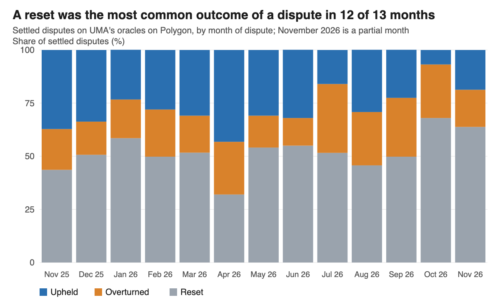
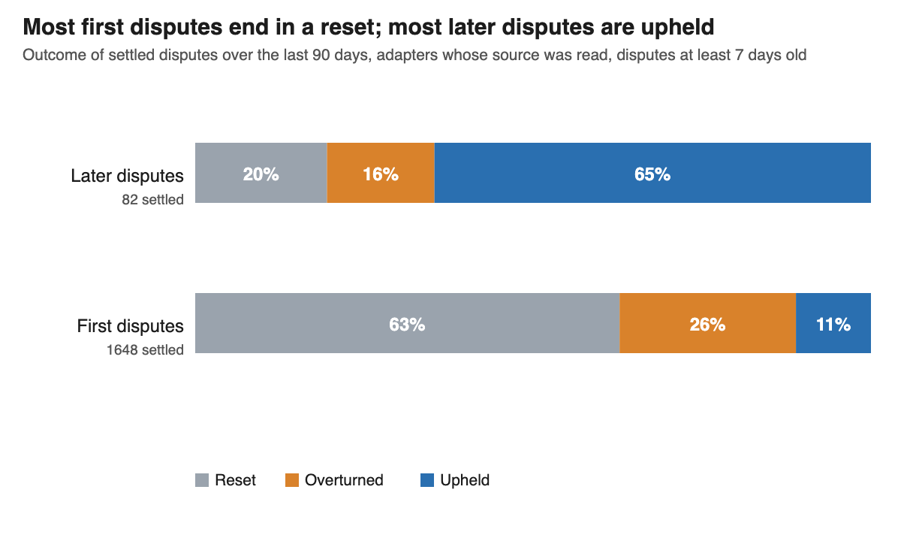
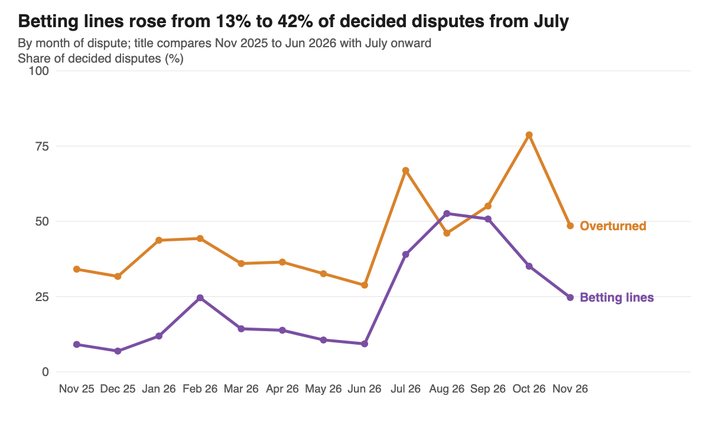
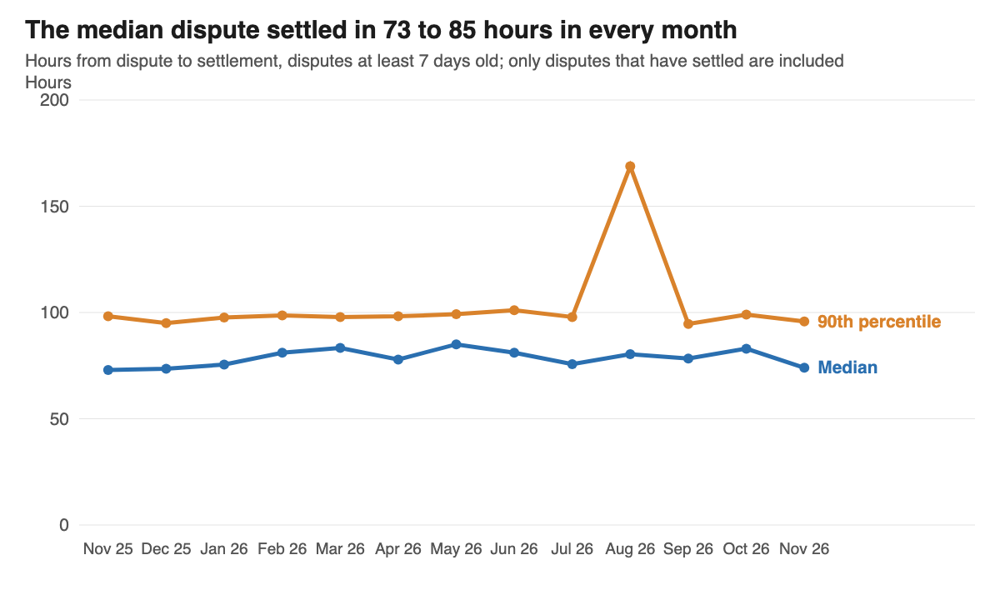

# Most disputes on UMA's oracles on Polygon end in a reset, and the overturned share rose after June

Over the last year 4,423 disputes settled on UMA's oracles on Polygon. More than half ended in a reset, meaning the vote returned "too early" and the question is asked again. About one in five overturned the proposed answer.

The share overturned among disputes that got an answer went from 36% to 61% after June. Among all settled disputes, overturns went from about 18% to about 26%. Pooled from July, most of the rise lines up with a change in which questions were disputed, and a larger share of disputes ending in a reset also raises the first figure. Month by month the fit is loose, and other rates rose as well.

## Mechanism

A requester contract asks a question. A proposer posts an answer with a bond, which is money that can be lost, and a challenge window follows. Without an objection the answer is final. A disputer also posts a bond, and the dispute goes to a vote of UMA token holders, which cannot finish in under about two days. A dispute is overturned if the final answer differs from the proposed one and upheld if it matches.

Polymarket's markets use adapter contracts. On a first dispute the adapter sends a new question and ignores the result of the first vote. On a later dispute there is no further reset, so that vote can decide the market, unless it also returns "too early". This is read from the verified source of five adapter contracts that sit behind nearly all disputes in the data. One is in Polymarket's published list.

## Twelve months

A reset was the most common outcome in 12 of the 13 months covered. The overturned share quoted above leaves resets out.

About nine in ten settled disputes in these adapters are first disputes, whose vote the adapter ignores. Over the last 90 days about two in three later disputes were upheld and about one in five ended in a reset again. Their overturned share of decided disputes rose from about 15% before July to about 24% from July, on 99 cases.

## July

Disputed questions were sorted by title with keyword rules into betting lines (over/unders, spreads, totals), player props, match results, season outcomes and non-sports. Betting lines went from about 13% of decided disputes before July to about 42% from July and were overturned about 70% of the time in both periods. Depending on the method, between about 18 and 24 of the 25 points of the rise line up with the change in mix.

The monthly fit is loose. With each month's own mix and each type at its earlier rate, the expected overturned share is about 63% for both August and October. The observed rates were 46% and 79%. Non-sports questions were overturned about 31% of the time from July against 20% before. The cause is unknown.

The 70% for betting lines is per request, and lines are disputed in bursts. From July, 425 decided line disputes fall into 181 bursts. The largest, 40 requests on 13 August, was entirely upheld. Without bursts of ten or more the rate is 84%. It is not a rate per game.

## Pricing

In the adapters read, a first dispute always sends a new request, so a disputed market waits for a second round whatever the vote returns. The median dispute took between three and three and a half days to settle in every month. The slowest that settled took about 20 days.

That is not a worst case. Three disputes older than a week have no settlement on chain, the oldest opened on 9 December 2025, and all three are on contracts outside the five adapters. A missing settlement does not prove the vote is undecided. No market was followed from first proposal to final resolution, so the time a position stays tied up is not measured.

## Limits

Disputers choose their cases and post a bond, so the figures show how often disputers prevail. They are not the share of proposals that are wrong, and undisputed wrong proposals are not in the data. Counts are of requests, not markets. The adapter logic is read from source, not traced on chain. Question types come from keyword rules, and some cells are small. The meaning of a settlement at the midpoint between two outcomes was not tested.

13 numeric predictions were written before any data was pulled. Five held and eight did not. The largest miss was resets: at most 15% of settled disputes were predicted to end that way, and more than half did.
